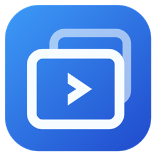
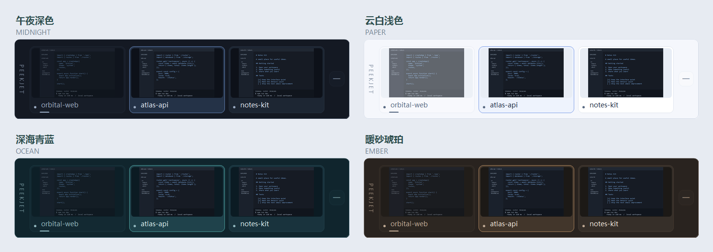

# PeekJet

**Preview your VS Code workspaces. Click to switch.**

**[Download for Windows](https://github.com/haochen12/PeekJet/releases/latest)** · [简体中文](README.md) · [Report an issue](https://github.com/haochen12/PeekJet/issues)

## Features

- **Typing avoidance**: when typing in an overlapping VS Code window, the dock becomes transparent and click-through. It recovers in place after about 1.2 seconds without typing, keeping editors and terminals clear. Enabled by default; optional in the menu.
- **Click-through and gradual activation**: idle translucency lets mouse actions reach the window underneath. Hover steadily to brighten and select; default 150ms, customizable from 50 to 2000ms.
- **Multiple monitors and four-edge docking**: follow the current VS Code window or pin a monitor, with dragging, cross-monitor movement and different display scales.
- **Live workspace previews**: supports VS Code / Insiders and project-name labels. The current editor is subdued; click another preview to switch or restore its window.
- **Automatic visibility**: stays visible when switching between multiple windows and hides when zero or one remains.
- **Personalization**: four themes plus system appearance, adjustable preview sizes and saved preferences.

## Get started

Requires **Windows 10/11 and .NET Framework 4.8**. No VS Code extension needed.

1. Download `PeekJet-vVERSION-windows.zip`, unzip it and run `PeekJet.exe`.
2. Open at least two VS Code windows. The dock appears automatically.
3. Hover steadily for **150ms**, then click a preview when the dock brightens.

## Controls

| Action | Result |
| --- | --- |
| Drag the activated dock | Snap to any screen edge or move across monitors |
| Wheel / arrows while active | Change pages, up to 10 previews per page |
| Far-right button | Minimize all VS Code windows |
| Right-click the tray / activated dock | Choose theme, size, monitor and activation delay, or quit |
| `Ctrl + Alt + V` / tray click | Show, hide or recall the dock |

Theme preview

## More

[Usage and FAQ](docs/USAGE.en.md) · [Build and development](docs/DEVELOPMENT.en.md) · [Contributing](CONTRIBUTING.md) · [Changelog](CHANGELOG.md)

This README describes main. See the changelog for released features. Settings are currently in Chinese.

Runs locally without networking or telemetry. [MIT](LICENSE). Independent community project, not an official Microsoft product.
