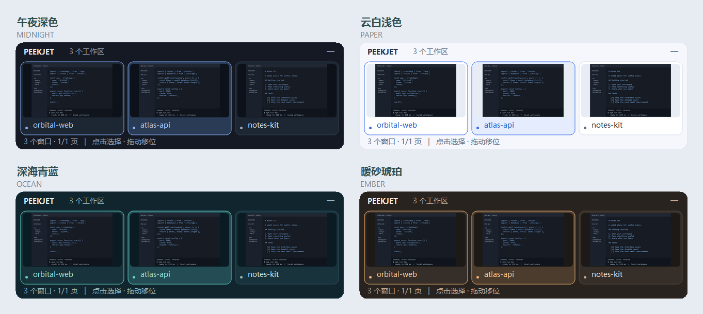

<div align="center">

# PeekJet · 闪览

**一眼看见，一点切换。**

轻量、多主题的 VS Code 实时窗口预览坞，让多个工作区切换更直观。

[](https://github.com/haochen12/PeekJet/actions/workflows/build.yml)
[](https://github.com/haochen12/PeekJet/releases/latest)
[](LICENSE)

[下载](https://github.com/haochen12/PeekJet/releases/latest) · [English](README.en.md) · [更新日志](CHANGELOG.md) · [问题反馈](https://github.com/haochen12/PeekJet/issues)

</div>



> 展示图使用程序绘制器和内置示例工作区，不包含用户的代码或桌面内容。README 对应 main 分支，已发布版本请查看 Release 与更新日志。

## 简介

打开多个 VS Code 项目后，不用反复切换窗口来找项目。PeekJet 将窗口内容缩成一组实时预览，停稳 **250 毫秒**后即可点击切换；闲置时半透明、鼠标穿透，输入时自动淡出避让。

- **原生实时预览**：使用 Windows DWM，支持 VS Code 和 Insiders。
- **四边停靠与拖拽**：默认顶部，上下横排、左右竖排，拖拽后吸附最近边缘。
- **双屏适配**：跟随当前 VS Code 或固定显示器，支持不同 DPI。
- **主题切换**：四套主题及跟随系统，覆盖卡片、标题、按钮和菜单。
- **减少干扰**：平滑渐亮、点击穿透、打字避让，仅剩一个窗口时自动隐藏。
- **便携离线**：无需安装、VS Code 扩展、账号或网络连接。

## 下载与安装

**运行环境：Windows 10 / 11，.NET Framework 4.8。**

1. 前往 [Releases](https://github.com/haochen12/PeekJet/releases/latest)，下载 `PeekJet-v版本号-windows.zip`。
2. 解压到任意目录，双击 `PeekJet.exe`。
3. 打开两个及以上 VS Code 窗口，预览面板会自动出现。

| 发布附件 | 用途 |
| --- | --- |
| `PeekJet-v版本号-windows.zip` | 便携程序，适合直接使用 |
| `PeekJet-v版本号-source.zip` | 源码与构建脚本 |
| `SHA256SUMS.txt` | 下载附件的 SHA-256 校验值 |

卸载时退出并删除程序文件即可；设置和日志可按下文路径单独清理。

## 使用方式

| 操作 | 效果 |
| --- | --- |
| 鼠标停稳 250 毫秒 | 面板渐亮，开启点击选择 |
| 点击项目预览 | 切换到对应 VS Code 窗口 |
| 激活后拖动预览或顶部空白处 | 移动面板，松开吸附最近边缘 |
| 激活后滚轮或点击箭头 | 窗口较多时翻页 |
| 鼠标离开面板 | 恢复半透明和鼠标穿透 |
| 右键托盘图标 | 打开设置或退出程序 |
| 激活后右键面板 | 打开同一套设置菜单 |
| `Ctrl + Alt + V` / 单击托盘图标 | 显示、隐藏或唤回预览 |

面板不放置设置按钮，保持界面简洁；主题、停靠边缘、大小、显示器和输入避让均在右键菜单中调整。右上角横线可手动隐藏。

多个窗口时点击切换不会隐藏面板；只剩一个或全部关闭时自动隐藏，重新打开多个窗口后恢复。手动隐藏会保留到下一次主动显示。重复启动只会唤回现有实例。

### 主题与大小

| 主题 | 配色 |
| --- | --- |
| 午夜深色 | 冷灰底色、柔和蓝色高亮，默认主题 |
| 云白浅色 | 白色卡片、深色文字、蓝色高亮 |
| 深海青蓝 | 深青底色、薄荷色高亮 |
| 暖砂琥珀 | 暖灰棕底色、琥珀色高亮 |
| 跟随系统 | 跟随 Windows 应用颜色模式 |

切换即时生效并自动保存。主题只改变 PeekJet，不改变预览中 VS Code 原本的颜色。预览宽度可选 **80 / 100 / 120 / 160** 逻辑像素，默认 100。

### 双屏与输入避让

自动跟随模式下，面板移到当前 VS Code 所在显示器。跨屏拖动面板会固定到目标屏，可从菜单重新开启自动跟随；固定屏幕断开后回退到可用屏幕。

输入避让默认开启：在与面板重叠的 VS Code 中打字时，面板完全透明且保持穿透；停打约 **1.2 秒**后在原位置渐显。避让不改变停靠边缘，底部不会自动跳到顶部。托盘或快捷键可立即唤回，菜单可关闭避让。

## 从源码构建

```powershell
git clone https://github.com/haochen12/PeekJet.git
cd PeekJet
powershell -NoProfile -ExecutionPolicy Bypass -File .\build.ps1
```

产物为 `dist/PeekJet.exe`。脚本使用 Windows 自带的 .NET Framework 编译器，不下载 SDK 或 NuGet 包。也可用 Visual Studio 打开 `PeekJet.csproj`，需要 .NET Framework 4.8 目标包。

```powershell
# 生成便携包和源码包
powershell -NoProfile -ExecutionPolicy Bypass -File .\package.ps1 -SkipBuild

# 检查主题渲染与文字对比度
Start-Process .\dist\PeekJet.exe '--self-test-themes' -Wait
Get-Content .\dist\theme-test.log
```

| 开发参数 | 用途 |
| --- | --- |
| `--self-test-themes` | 离屏渲染、对比度、系统模式与状态保持；用于 Windows CI |
| `--self-test` | 完整桌面交互检查，需要解锁桌面 |
| `--self-test-avoidance` | 避让状态检查，跳过真实键盘与屏幕像素检查 |
| `--render-themes` | 重新生成示例主题图 |

完整检查会短暂打开测试窗口，并向测试窗口发送 F24，不输入文本或终端命令。GitHub Actions 自动编译、执行主题检查并生成构建附件。

## 隐私与已知限制

- **本地运行**：无联网、遥测、录屏或定时截屏，预览由 DWM 合成。
- **输入检测**：只保留按键事件时间和前台窗口句柄，不读取或保存键值和输入文本，按键原样转发。
- **最小化窗口**：可能显示系统缓存画面，恢复后继续更新。
- **虚拟桌面与权限**：其他虚拟桌面上被系统隐藏的窗口不列入预览；Windows 可能限制切换到管理员权限的 VS Code。
- **项目名识别**：依赖标准窗口标题，自定义标题可能影响识别。

设置：`HKEY_CURRENT_USER\Software\PeekJet`。旧版 VSCodePreview 设置可作为迁移来源。

日志：`%LOCALAPPDATA%\PeekJet\error.log`。不自动设置开机启动。

## 参与贡献

欢迎反馈问题、改进主题和提交 Pull Request。请先阅读 [贡献指南](CONTRIBUTING.md)，反馈问题时提供复现步骤、Windows 版本、显示器数量和缩放比例。

| 源码 | 职责 |
| --- | --- |
| `Program.cs` | 预览布局、交互、拖拽和输入避让 |
| `Native.cs` | Win32 / DWM 接口 |
| `Themes.cs` | 主题、圆角绘制和菜单配色 |
| `SelfTest.cs` | 集成检查 |
| `ThemeGallery.cs` | 示例工作区与展示图生成 |

## 开源协议

[MIT License](LICENSE) © PeekJet contributors。

PeekJet 是独立社区项目，并非 Microsoft 官方产品。
